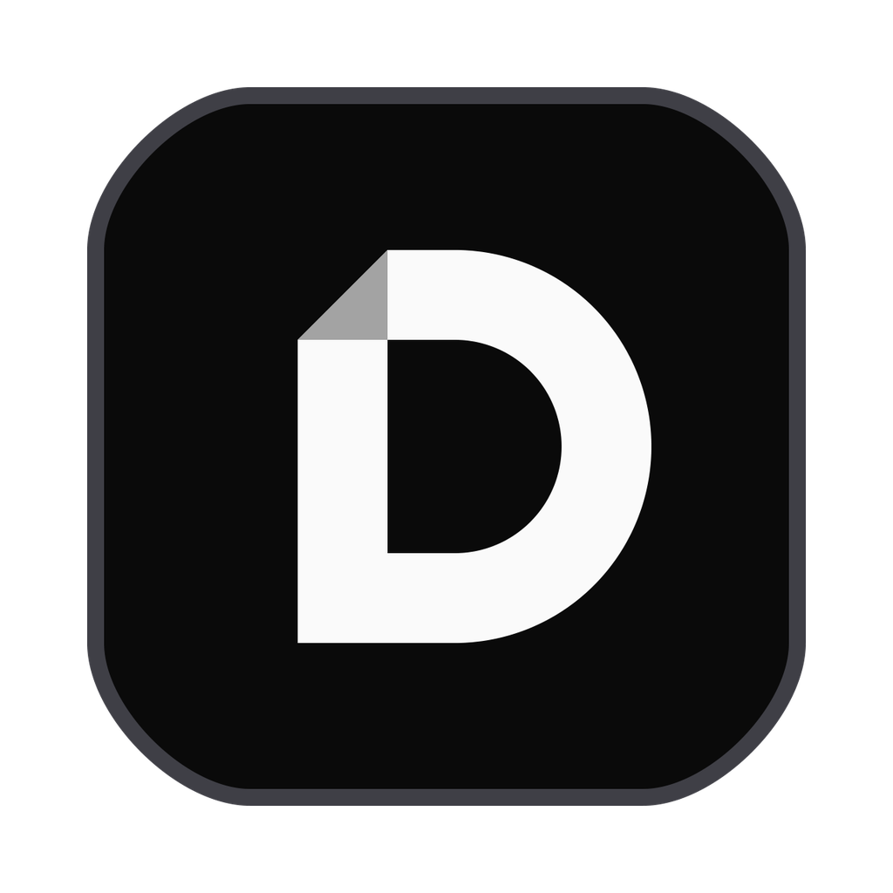
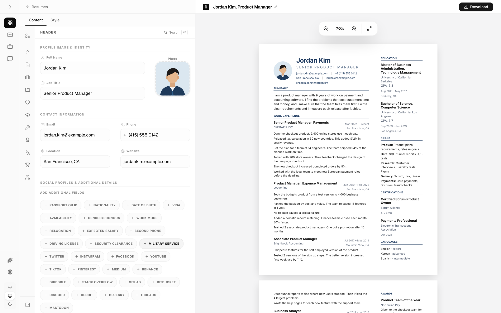
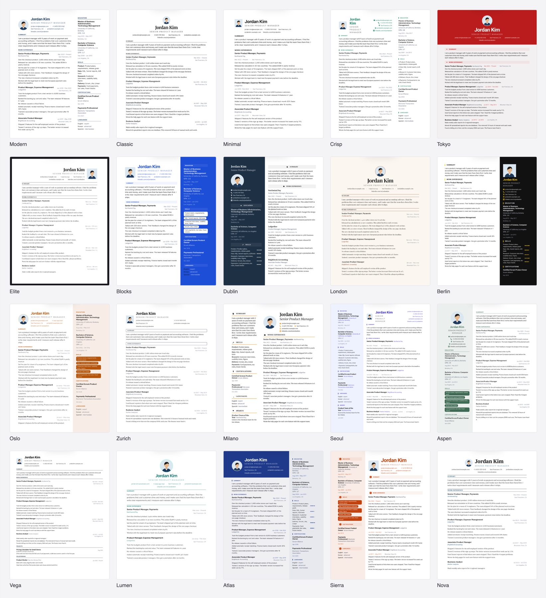
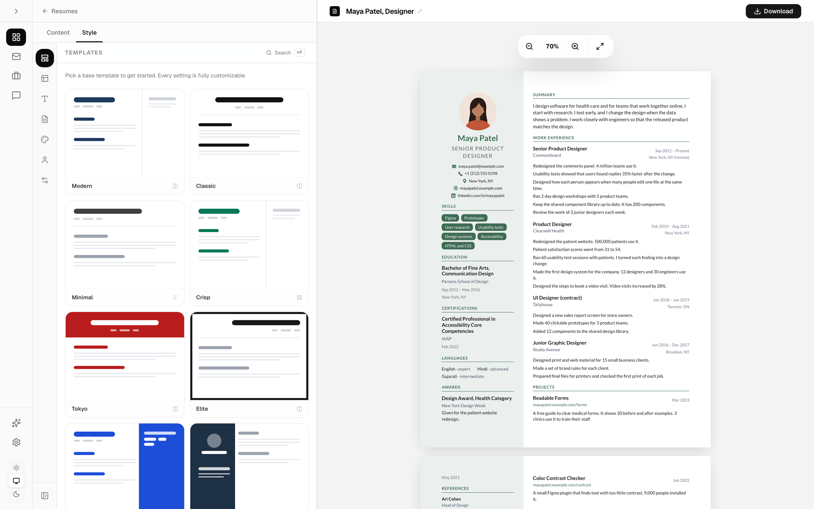
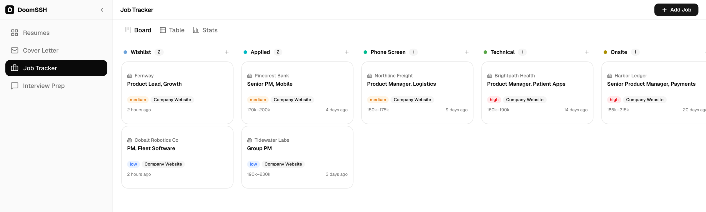
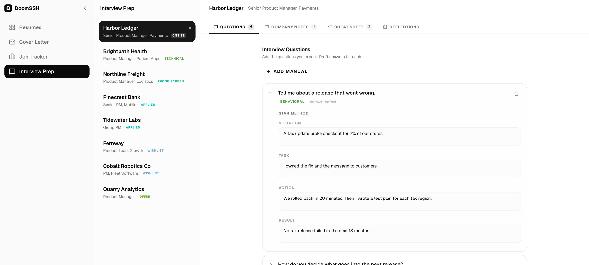
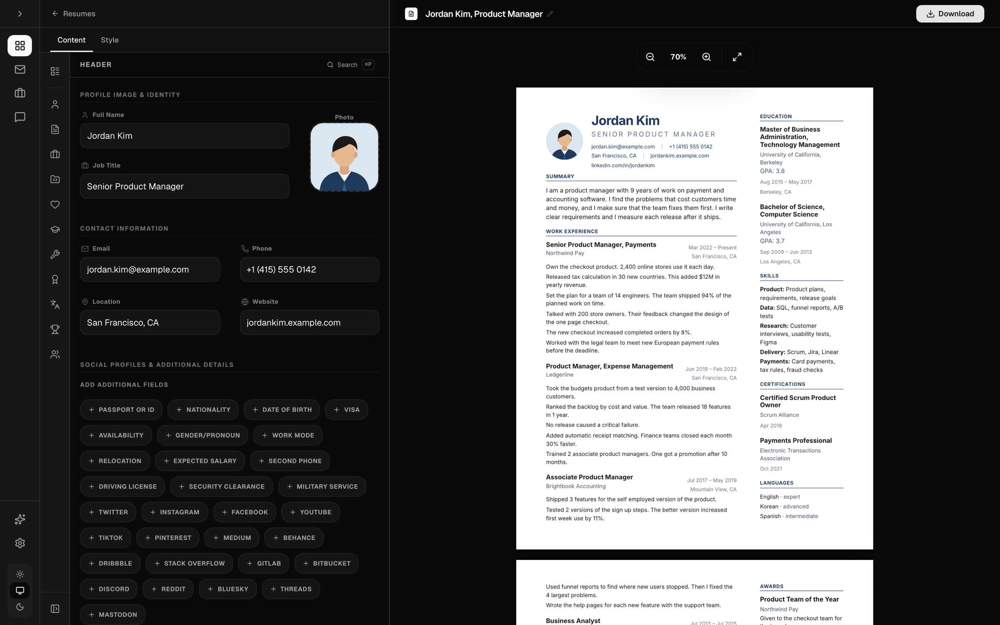

<div align="center">



# DoomSSH

**A resume builder that keeps your files on your computer.**

No account. No upload. No subscription.

[Download](https://github.com/a64mahmo/doomssh-electron/releases/latest) · [Run from source](#run-from-source) · [Docs](docs/index.md)

</div>

<p align="center">
  
</p>

## What it does

DoomSSH helps you write a resume and send it as a PDF.

1. You type your details on the left.
2. The resume on the right changes while you type.
3. You click **Download** to get a PDF.

The PDF is the same as the page you see. Nothing moves when you export.

## Why use it

Most resume sites keep your resume on their server. Some ask you to pay before you can download it.

DoomSSH does not do this.

* Your resumes stay on your computer.
* The desktop app works with no internet connection.
* You can download your PDF at any time, free.
* Each resume is a plain JSON file. You can open it, copy it, or keep it in Git.

## Pick a look

There are 20 templates. You can change to a different template with one click. Your text stays the same.

<p align="center">
  
</p>

You can also change the fonts, colors, margins, columns, and section headings. Open the **Style** tab to do this.

<p align="center">
  
</p>

## Track your job search

The **Job Tracker** shows each job you want or applied for. Move a job from one column to the next when its status changes. You can link each job to the resume and cover letter that you sent.

<p align="center">
  
</p>

## Get ready for interviews

**Interview Prep** keeps your notes for each job in one place:

* The questions you think they will ask.
* Your answers, in four parts: situation, task, action, result.
* Notes about the company.
* A short list of points to say.
* What went well after the interview, and what to do next.

<p align="center">
  
</p>

## Also included

* **Cover letters.** Write them next to your resumes. Your name and contact details come from the resume.
* **Example resumes.** Start from a Product Manager, Designer, or New Grad example. Then change the text to your own.
* **Search.** Press <kbd>⌘</kbd> <kbd>P</kbd> (Mac) or <kbd>Ctrl</kbd> <kbd>P</kbd> (Windows) to find a field or a setting.
* **Dark mode.**

<p align="center">
  
</p>

## Where your data goes

| App | Where your files are |
| :-- | :-- |
| Desktop app | A folder on your computer. You can choose the folder. |
| Browser | The browser's own storage on your computer. |

The app has no server and no account. Nobody else can see your resumes.

## Download

Get the installer from the [Releases page](https://github.com/a64mahmo/doomssh-electron/releases/latest).

* **Mac:** download the `.dmg` file.
* **Windows:** download the `.exe` file.

The desktop app tells you when a new version is available.

## Run from source

You need [Node.js](https://nodejs.org) (the LTS version).

```bash
npm run install-all   # install everything
npm run dev           # start the desktop app
```

To make the installers:

```bash
npm run electron:dist
```

To run only the browser version:

```bash
cd frontend
NEXT_PUBLIC_APP_PLATFORM=web npm run dev
```

Then open <http://localhost:3000>.

To run the tests:

```bash
npm run test --prefix frontend   # unit tests
npm run test:all                 # all tests
```

## How it is built

| Part | Tool |
| :-- | :-- |
| Desktop app | Electron |
| Screens | Next.js, React, Tailwind CSS |
| App state | Zustand |
| Storage | JSON files (desktop), IndexedDB (browser) |
| PDF | The resume page, printed by Chromium |

To learn more, read these documents:

* [Architecture](docs/architecture.md): how the parts work together.
* [Frontend](docs/frontend.md): screens, components, and state.
* [Electron](docs/electron.md): the desktop app and its security.
* [Templates](docs/template-customization.md): all settings, and how to add a template.
* [Deployment](docs/deployment.md): how to put the browser version online.
* [Troubleshooting](docs/troubleshooting.md): fixes for common problems.

## License

[MIT](LICENSE). You can use, change, and share this code.
